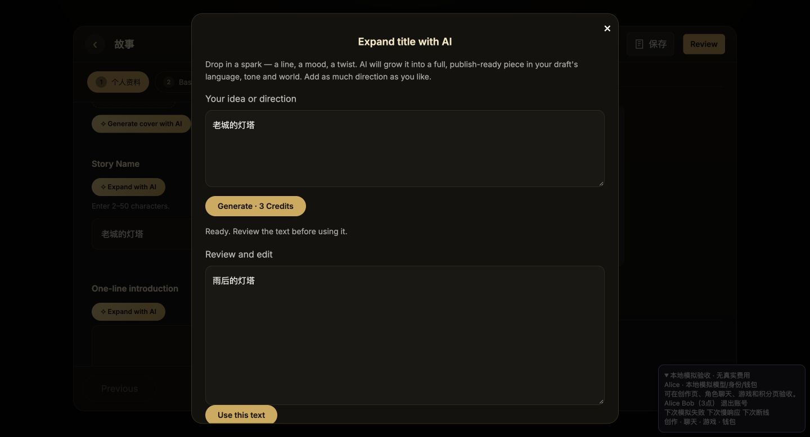
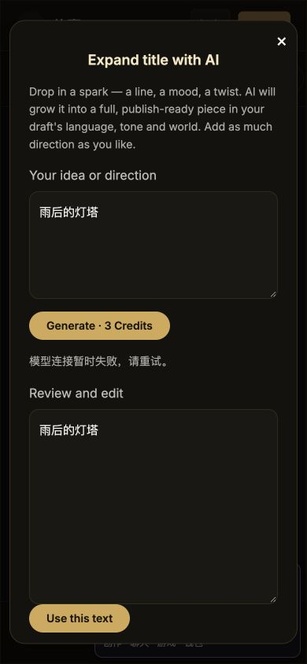
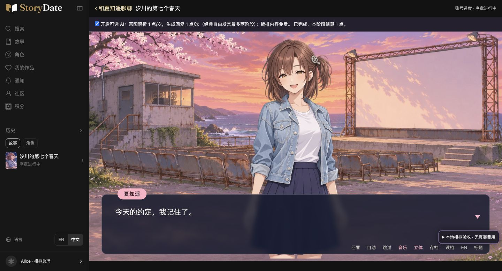
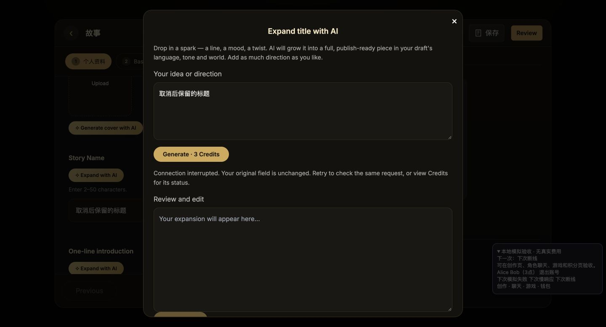
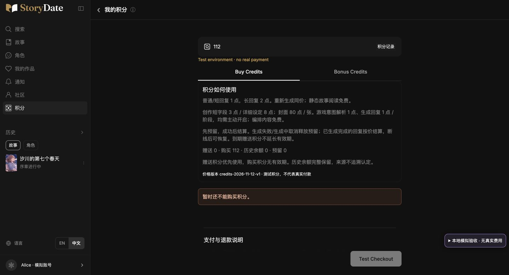
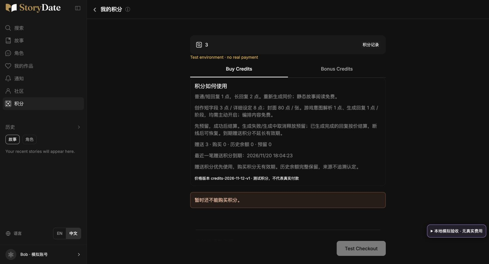
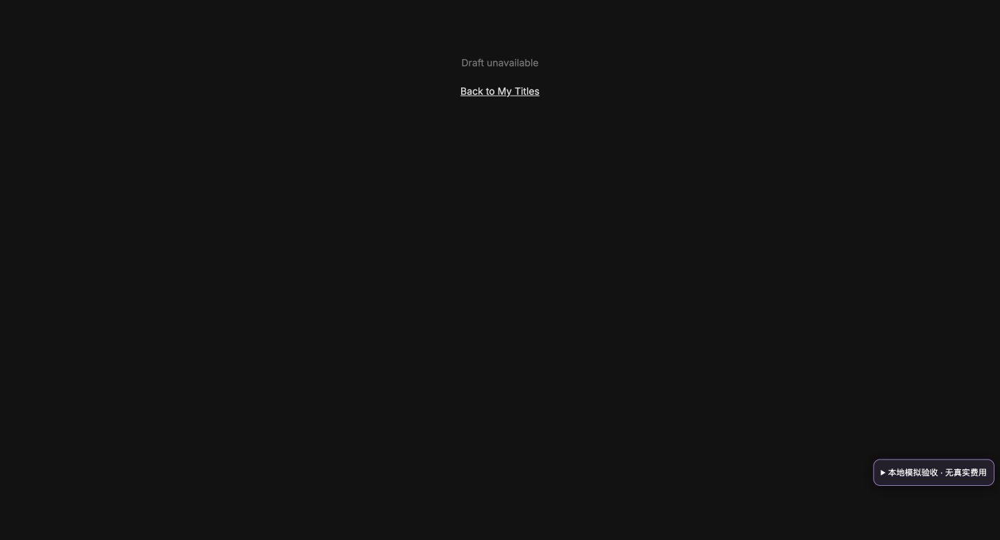

# 积分消费与定向补贴验收

2026-11-13 恢复推进。关联 #150，PR #151，分支 `codex/credits-v1-20261112`，依赖未合并的 #149。未合并 main，未修改托管配置，未调用付费模型、支付或真实发放。

规则见 [积分与补贴 v1](../product/2026-11-13-credits-v1.md)，原体检逐项处置及上线门槛见 [本轮交接](../handoffs/2026-11-13-credits-resume.md)。

## 已完成的工程

- 聊天、创作助手、封面、游戏理解/表达统一经过报价、身份验证、原子预留、成功结算、失败释放；游戏可选 AI 默认关闭。
- 购买/赠送/历史余额分账；活动白名单、预算、期限和防重复领取；工具默认离线计划。
- 成功结果 24 小时恢复，消费凭证长期独立保存，图片大结果分块；10 分钟预留租期后在下次钱包操作恢复。
- Stripe 已签名退款/争议事件核验订单后冲正；已消费的退款点数单列，必要时暂停新消费；赠送余额不受牵连。
- 全入口脱敏用量日志，按供应商尝试分别记录失败/备用、时长、token/图片数量；未知成本不记成零。钱包只读报告加入净冲正、未覆盖点数及逐钱包守恒。
- 本轮验收发现并修复：坏 PNG 在 HTTP 200 时仍会结算；游戏完成后状态条仍显示生成中；切换账号后等候中的一个流分块仍可能透出；创作断线只显示原始 network error。

## 自动化验证

`npm run build`、`npm run check`：**270 项全部通过**；`git diff --check` 通过。

覆盖账号隔离、并发防透支、重复请求/内容冲突、成功/取消/截断/失败、结果恢复、活动预算与到期、旧余额迁移、退款/拒付/乱序重放、资金守恒、损坏图片释放、断线与账号切换、用量未知/重复/冲突、安全默认运维工具。用例使用本地模型/事务替身，不调用真实服务。

真实 Firebase SDK 的 Auth/Firestore 模拟器另由 GitHub Actions 的 `firebase-emulator` 执行，使用 `demo-storydate-credits`，不使用云端账号/凭证。前次功能提交 `6a1efaa` 的 [run 43365127799](https://github.com/storyloveai/ocai/actions/runs/43365127799) 已通过；本轮提交的 CI 结果以 PR checks 为准，不能用前次记录冒充新提交。

## 完整网站浏览器验收

`cd ooc-replica && node scripts/credits-site-lab.mjs`，访问 `http://127.0.0.1:3113`。只监听回环地址，使用真实网站组件/API 处理器及本地身份、模型、钱包替身；不接 Firebase 云端、Stripe 或模型供应商。替身和工具条均在 tests/scripts 下，不进入 dist。封面 fixture 是可解码的单像素 PNG，仅验证账单/应用交互，不代表真实模型画质。

| 检查 | 实测结果 |
| --- | --- |
| 桌面作者助手 | 生成前显示 3 点；生成后仅在点击 Use this text 才覆盖原字段；保存草稿可重开 |
| 手机作者失败 | 390×844 响应式视口，失败保留输入及原字段，弹窗控件可操作 |
| 手机封面成功/失败 | 显示 80 点；成功后用户主动应用；下一次失败保留原封面，预留释放 |
| 双模拟账号 | Alice 的草稿/余额不出现在 Bob；Bob 仅有 3 点，封面余额不足时保留输入；跨账号访问草稿显示 unavailable |
| 手机游戏 | AI 默认关闭；理解/表达各 1 点在开启处明示；编排内容免费；视口内能操作 |
| 桌面游戏完成 | 主动开启，生成回复后显示“已完成，本阶段结算 1 点”；继续已生成对话不再调用模型 |
| 主动停止 | 慢响应点击 Stop，显示 Stopped，原稿保留、不可应用空结果 |
| 中途断线 | 显示连接中断及原请求核对提示；原稿保留；同内容重试成功，原字段仍需手动应用 |
| 最终余额核对 | 模拟服务重启后 200 → 成功封面 -80 → 两次游戏 -2 → 两次作者成功 -6 = 112；失败/停止/两次断线无额外扣款，预留 0 |

手机检查是浏览器响应式模拟，不是实体手机，也不是跨设备云端验收。第一次作者成功截图的 197 是服务重启前的独立流程，不混入最后 112 的计算。

其余截图同目录：封面成功/失败、余额不足、Bob 空作品库、作者取消和早期余额核对。之前聊天/活动领取验收保留在 `assets/credits-v1/`，不替代本次扩展验收。

## 继续推进：跨标签页隐私与真实 SDK 用例

- 发现并修复：账号变化时路由重绘，但全局 dialog 仍保留旧账号的积分明细或创作内容。现在先关闭弹窗（触发生成取消），再清空 DOM，最后恢复新账号页面。
- 本地双标签页模拟身份通知：A 页打开 Alice 的 200 点明细，在 B 页切 Bob；A 页立即关闭并清空旧明细，只显示 Bob 的 3 点。创作慢响应期间同样切换，旧草稿 unavailable、弹窗清空；切回 Alice 后已保存草稿仍在，余额 200、预留 0。
- 发现并修复：已有身份但公共配置晚返回时，钱包只重绘而未加载。配置就绪会自动读余额；积分页页面标题也正确更新。
- 新增 `tests/integration/funding-emulator.test.mjs` 四项真实 SDK 用例：签名事件并发到账一次/跨账号订单拒绝，退款时已消费及预留点数和赠送保护，争议胜诉与乱序事件，Timestamp 到期拒绝恢复及临时缓存物理清理后凭证保留。Stripe 返回仍是本地替身；只用回环的 demo Firebase 模拟器，不代表真实 Stripe 或托管 TTL 已验收。
- 模拟器清理用旧时钟构造过期样本，不清空整个项目，不删除并行测试的新缓存；本机无 Java，由本 PR 的 Java 21 CI 执行真实 SDK 用例。具体新提交结果见 PR checks/交付评论。

## 仍未具备的真实验收

1. 最后一次只读环境名称/范围检查显示，Firebase 登录/服务端与 Stripe 钱包配置仅在 Production。用户未确认 Preview 已补测试配置；本轮不读取、复制任何值。
2. 测试 Firebase 的真实双账号、跨设备、云端恢复/并发事务，以及真实测试 webhook 的购买/退款/争议。
3. 托管平台临时结果与分块 `expiresAt` TTL 的实际配置/物理清理；服务端读取过期判断已实现。
4. 获准预算后的真实模型质量、时长、供应商账单与定价核算；活动预算、条款和启用时间由用户确认。

这些是待完成的上线条件。当前可评审、可用本地模拟复盘；不能称“真实扣费已上线”。
