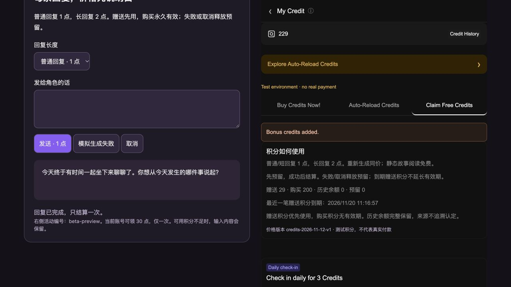
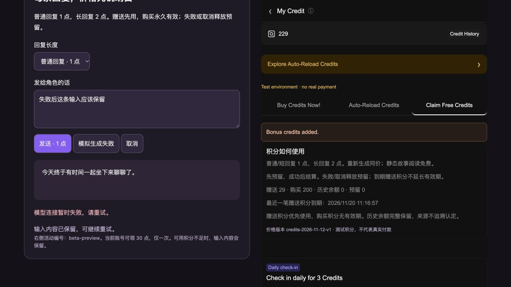
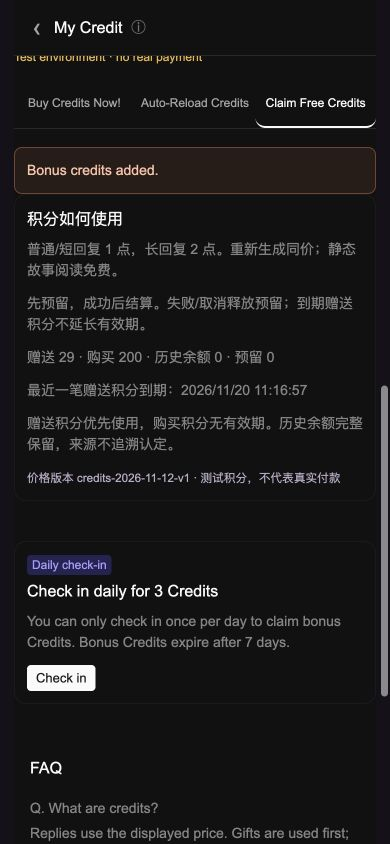

# 积分消费与定向补贴验收

关联 #150，分支 `codex/credits-v1-20261112`，基于尚未合并的 #149。未合并 main，未修改托管配置，未调用付费模型、支付或真实发放。

方案、价格、上线前置条件见 [积分与补贴 v1](../product/2026-11-13-credits-v1.md)。

## 实现范围

- v2 钱包：赠送 / 购买 / 历史余额分账，预留、结算、释放、赠送到期及完整流水。
- `/api/chat`：认证、服务端价格校验、请求幂等、并发防透支，回复成功结束才结算。
- 24 小时回复恢复与独立消费凭证；10 分钟预留租期，账号下一次操作时恢复崩溃后的余额。
- 用户界面：发送前点价、钱包分账、赠送期限、活动领取；余额不足时保留输入，重新生成预检失败不删除原回复。
- 活动：名单、预算、时间、每人一次；dry-run 发放工具和只读汇总工具。未运行真实操作。
- 非聊天的旧 AI 入口在收费模式拒绝调用，防止漏扣和未报价扣款；关闭收费时保持现状。这些入口的正式收费交互尚未完成。

## 自动化验证

`npm run build`、`npm run check`、`git diff --check`。

新增覆盖并发争抢、同请求重复扣账 / 换内容冲突、跨账号隔离、服务失败 / 取消 / 截断释放、回复恢复、测试与正式环境隔离、不可用钱包拒绝生成、签到和活动重入、预算争抢、旧余额和旧写入器兼容、到期期间的预留释放、完整流水守恒、报价期间切换账号和敏感错误脱敏。事务测试替身会拒绝“写入以后再读取”，模拟 Firestore 的读写顺序约束。

最终本地 237 项全部通过，包含资金守恒、UI 明细、旧写入器兼容、截断回复、停止已结算回复动画、敏感错误处理。未使用真实 Firestore 或 Firebase Auth，不把内存事务测试等同于线上验收。

## 浏览器验证（本地模拟）

运行：`cd ooc-replica && node scripts/credits-lab.mjs`，打开 `http://127.0.0.1:3112/?creditTab=free`。仅监听回环地址，模拟账号 / 模型，没有真实凭证；验收页没有进入生产静态目录。

1. 初始模拟购买余额 200，活动 `beta-preview` 领取 30，余额变成 230，显示赠送 30 / 购买 200。
2. 普通回复成功后余额 229，赠送 29 / 购买 200 / 预留 0，确认先花赠送、只扣 1 点。
3. 模拟已输出部分内容后模型失败：余额仍为 229、预留 0，输入保留。
4. 390×844 手机尺寸检查聊天控件、钱包和分账信息；这是响应式浏览器检查，未使用实体手机。

## 仍需验收

- Preview Firebase 测试登录配置仍未补齐，沿用用户“真实账号稍后验收”的决定；未读取/复制任何配置值。
- 测试 Firebase 的双账号、跨设备、真实并发事务、真实网络断开恢复。
- 回复缓存 TTL 需要在托管平台配置；服务端已拒绝返回过期正文，但未验证物理清理。
- 真实模型的质量、响应时长和供应商账单成本，获准后再测。零售价格仍是试行建议。
- 创作 / 生图 / 结构化游戏自由发言的报价及账号交互、真实小额购买到账、活动预算和用户说明审核。

因此本 PR 可以评审工程，不能被当成“正式收费已经上线”。
