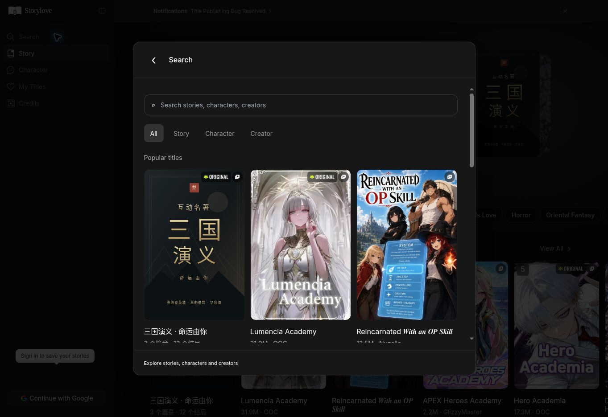

# Dialog, authoring and community maintenance — 2026-10-20

Baseline: `9c62b9fc2828afb247f06224c8feabc00b21161c`, branch `feat/ooc-high-fidelity-replica`, app `ooc-replica/`, existing production `https://project-zhmv2.vercel.app/`.

## Source observations and tool limits

Read both repository READMEs and the prior acceptance report. Read official `morluto/rea` `.agents/skills/reverse-engineer-anything/SKILL.md` v42 and its connection/recovery and runtime-observation references. REA doctor failed with `capability_unavailable`: process ownership inspection cannot read procps process information. No system or MCP configuration was changed, and no REA score is claimed.

The supported cloud browser loaded the original home, Lumencia Academy, OOC Creator Profile and Your New beautiful neighbour. Public DOM confirmed descriptions, settings, prologue/intro, comments and profile links, Titles/Feed, Story/Character and Follow. Original terms and content-preference overlays remain present in this new browser session; no terms were accepted and no original social actions were submitted. Existing captured public HTML supplies the comments and usernames; these are snapshots, not current original-service accounts.

## Implementation

- Search opens a native dialog above the current page with an independent scroll region, 44px back target, content-type filters and creator results. Direct `/search` uses the same dialog over the browsing shell.
- Every catalogue story and character card supports a quick-view dialog, including Three Kingdoms. Six complete captured story previews and the captured neighbour character keep their actual public descriptions. Other titles have a consistent layout and explicitly disclose when their full description has not been captured. Explicit full-information navigation remains available.
- Home ranking/genre tabs keep the hero, sidebar and tab strip mounted, update the content below, preserve the URL and offer sorting. Collection routes remain available for View All.
- Shared history handles both message arrays and Three Kingdoms chapter objects; other chat sessions no longer drop the latter from their sidebar. Opening a Three Kingdoms play session registers it in account-scoped history.
- All eight text authoring fields offer real AI expansion through the existing same-origin `/api/chat` stream, its rate limits, DeepSeek primary and Gemini fallback. Server-owned author prompts validate the field and bound the draft text. Cover data is omitted from requests. Generated text streams into a review box and supports stop, retry, editing and explicit apply. Applying does not silently save or publish. Cover generation remains disconnected; uploads remain available.
- Captured creator/comment names open independent Storylove creator profiles. Titles and Feed tabs, Story/Character filtering, sorting, follow/unfollow, share/copy, comment likes and threaded local replies work. Activity uses existing owner-only account storage and the already-permitted `ooc-comments-*` namespace; no Firestore rule or schema change is needed. Disclosures explain that this is private Storylove activity, not interaction with original OOC users.
- Notification typography is reduced to the shared UI scale. Dialogs, creation controls and creator grids include narrow-screen rules.

## Validation before publication

`npm run build`, `npm run check` (89 passed, 0 failed/skipped) and `git diff --check` passed. Existing Firebase isolation, hosted checkout, streaming, fallback and Three Kingdoms tests remain green. New tests exercise object-shaped history, all eight author prompts, uncaptured and captured story/character dialogs, search background preservation, local category rendering, comment likes/replies, follow restoration, streamed author review/apply, omitted cover payload, and error recovery.

These are automated checks. Production browser acceptance is recorded separately after the deployment completes. Mobile CSS checks do not certify a real mobile viewport or physical handset. Shared multi-user publishing/notifications are not implemented; the user requested an initial demonstration user library.

## Production browser acceptance

Core production releases `743a527`, `4c9fd30` and `bc9bf1a` reached READY with `project-zhmv2.vercel.app` attached and no alias error. The final small follow-up includes character bookmark/options/hashtag wiring, accurate close labels and scrolling the reply composer into view, plus this report and screenshot.

Actually exercised in the supported browser at 1363 × 936:

- Search stayed on `/` over the visible home. Its dialog measured 768 × 748.8px at x=297.5/y=93.6; the back button measured 44 × 44px and document scrolling was locked. Close restored the background. Search → Creator → OOC opened Creator Profile. `#fantasy` returned six matching captured catalogue entries.
- Rankings and Today each rendered 100 story entries without replacing the hero or sidebar or changing the URL. After the initial automated target positioning, consecutive Today → Main switches kept scrollY=14, heroY=78 and tabY=450 exactly; Main restored the original rails. The first automated click from scrollY=0 did show a 14px scroll, consistent with target centering but not independently attributed. Physical pointer/touch first-click positioning remains a verification limit; no claim of a whole-page zero-pixel comparison is made.
- Lumencia opened in a Story Information dialog with its captured description and comment names. A like toggled to `+1`; a reply was saved with a parent reference and appeared in Newest order. Clicking AelphixX5WFsD opened the corresponding profile.
- The captured neighbour character opened in a Character Information dialog with the actual Detailed Description, Avatar Settings, Intro Preview and 20 captured comments. The screenshot was visually inspected for header, cover, content scrolling and fixed New Play action. Other character/story types and Three Kingdoms quick views are covered by the automated regression.
- OOC Follow changed to Following; a full reload retained the state and 92,828 snapshot-plus-local count. Share displayed `Profile link shared`. Titles and Feed switched independently. No original OOC follow/comment action was submitted.
- In Create Title, entered `雾城来信` and one Chinese sentence describing an amnesiac postal worker delivering letters from the future. A real configured model request generated 795 Chinese characters of coherent setting, characters and choices. Before apply, Story Details remained empty. Use this text → Save draft succeeded, and after a full reload Story Details still contained all 795 characters. The testing draft is only in the browser guest cache. This was a real inference request, not a simulated fixture; no checkout was submitted.
- Three Kingdoms → New Play → return to Story → Lumencia → New Play retained Three Kingdoms in the left History list. A full reload of Lumencia still showed it. Object-shaped chapter progress is additionally exercised by automated save-bridge/history tests.
- Session Notifications now uses All / News / Like / Comment / Follow tabs. The real browser measured heading and empty-state text at 16px and body copy at 14px; Comment selection worked.
- A sample of up to 100 captured browser errors returned no application errors after excluding extension metadata errors. This is a browser sample, not a server log audit.

## Remaining scope

This is not full original-site fidelity acceptance. Complete descriptions for uncaptured titles, all original publishing/advanced creator tools, genuinely shared multi-user community activity and real notification delivery remain incomplete. No new real-account Firebase cloud-sync/OAuth or Stripe payment completion was performed; existing configuration and tests are preserved. No real charge was made and no secret was read, changed or committed. No mobile viewport or physical phone was available through the supported browser API; narrow-screen visual acceptance remains outstanding. REA runtime evidence remains unavailable for the environment reason above.
