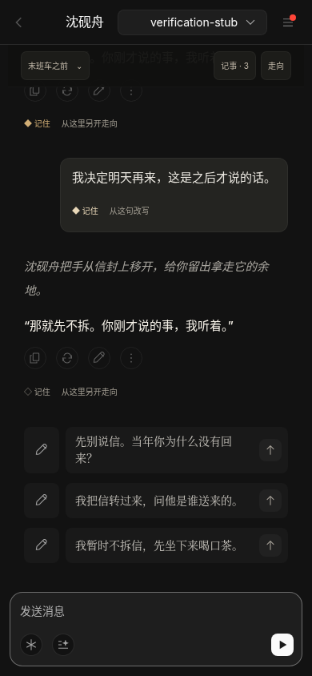

# Character · 原创相遇与对话阅读

本轮由 Codex 按用户授权独立制作人物、配图、开场和网站对话机制。分支 `codex/character-stories`，以最新主干 `d0f02a8` 为基础，尚未合并上线。

## 先看效果

[电脑角色页](characters-desktop-zh.png) · [手机角色页](characters-mobile-zh.png) · [对白与叙述分层](reading-mobile-zh.png) · [生成中断后续聊](resume-after-interruption-mobile.png)




[英文角色页](characters-desktop-en.png) · [英文界面阅读效果](reading-desktop-en.png)

## 三位原创人物，六场独立相遇

| 人物 | 年龄和设定 | 可以进入的相遇 |
|---|---|---|
| 沈砚舟 | 31 岁，雾港的旧案调查员；克制、认真，关心通过行动表达 | 末班车之前：重逢与一封未拆的信；一通未接来电：初识后的深夜来访 |
| 陆闻笙 | 28 岁，剧场作曲者；会抬杠，也会认真修改自己的作品 | 最后一个音：合作中的分歧；留给谁的座位：开演前的初次相遇 |
| 林照晚 | 29 岁，照片修复师；温和、有主见，尊重别人对过去的选择 | 照片背面的空白：保留还是修复；打烊后的来客：邻居与五分钟休息 |

六场相遇分别定义初始关系、眼前的问题和人物目标；同一个人物的不同相遇分开保存。用户保留自己的名字、身份和性别，具体回应决定后续发生什么。

原六位三国人物的人设与已采用头像继续保留；周瑜、吕布、貂蝉的原入口仍可使用。目录共十二位，其中三位原创和六位三国人物有独立的完整网站人设配置。

三张新图使用内置 `image_gen.imagegen`，未调用外部按张计费图片 API。未裁的 PNG、WebP 和哈希记录见 [配图来源](../../../character-art/README.md)。只做了 WebP 文件编码，人物、画面与原尺寸均未修改。

## 一实一虚的阅读层级

- 人物说出口的话：暖白 `#F5F1E8`，正体，字重 500。
- 动作、神态与环境：暖灰 `#A9A69F`，斜体，字重 400。
- 两层均保持清晰可读，浏览器按 `#111111` 背景实测达到普通文字 4.5:1 的对比度要求；没有模糊滤镜或降低文字透明度。
- 支持中文引号、英文引号、动作中的对白和流式未完成片段；代码块、HTML 属性及转义文本保持完整。
- 已存消息和正在生成的文字使用同一个展示规则。用户自己的消息保留清晰的独立消息框。

Zeta 当前页面在本环境中访问受阻。本版依据用户“一实一虚”的描述制作独立的对白/叙述层级，Zeta 的实时界面细节尚未核实。

## 对话机制

**记事**：在某句旁点击“记住”，保存原句节选和说话者。记事面板可查看、移除；后续回复与建议携带这些连续性资料。对方说过的话被标注为角色陈述，避免直接当成客观事实。最多保留六条，原句被修改时对应旧记事会失效。

**另一种走向**：在角色某句后另开分支，或从自己的某句话开始改写。原对话会保留，可从“走向”切回来。新分支只继承那个时刻已有的消息和记事；之后才发生的事不会提前出现。可以确认删除不再需要的非当前走向。

**另一场相遇**：切换场景时另存对话，初始关系和记事重新开始。后端根据允许的场景 ID 选择人设和开场，客户端不能直接指定任意服务端设定。

**中断恢复**：发送时先保存用户原句。生成中离开会保留已显示的片段；刷新后如果还没有回复，可以点击“继续回复”，不会把用户原句重复发送成两句话。旧页面和旧请求受当前走向及视图校验约束，不能覆盖新对话。

现有 `ooc-session-v2-<id>` 仍保留当前聊天数组，历史和旧聊天继续可读。分支和记事通过现有账户存储接口保存，键名符合已有云同步范围；不同人物分别保存。真实 Firebase 的跨设备并发一致性仍需 Preview 环境验证。

## 验证结果

| 检查 | 结果 |
|---|---|
| `npm run build` | PASS |
| `npm run check` | 175/175 PASS |
| 新增专项 | 阅读层、流式片段、转义、场景校验、人设请求隔离、旧聊天、分支/记事继承、迟到写入、存储失败回滚、来源修正和云同步键名 |
| Chromium 完整流程 | 81/81 PASS，中英文×1440×1000 和 390×844；覆盖三位人物全部六场相遇、对比度、发送、记事、改写/分支、切回、删除、刷新、原人物和首句链接 |
| Chromium 中断恢复 | 4/4 PASS，生成中刷新保留用户原句、继续回复不重复、改写预填并保存原对话、移除记事 |
| 脚本异常 / 本轮资源 404 / 横向溢出 | 0 / 0 / 0 |

[完整浏览器记录](browser-results.json) · [中断恢复记录](interruption-results.json)

浏览器通过真实的网站组件和 `buildPrompt` 使用本地模拟模型，只验证展示、存储、请求和服务端人设绑定。**真实模型的对白质感尚未验收**。截图中的 `verification-stub` 明确表示本地模拟模型；模拟服务不在网站交付代码里。

## 运行与评审

```sh
cd ooc-replica
npm ci
npm run build
npm run check
npm start
```

本地静态服务：`http://127.0.0.1:3000/character`。真实 AI 继续使用 Vercel 的 `/api/chat` 及其服务端配置。

本轮以 main 为 PR base，已包含上一轮尚未发布的三国角色接入；无需再依赖 `codex/38-chat`。只修改网站角色模块与新增配图，Claude 可以继续独立推进游戏；正式三国图、剧情、规则、引擎、同步生成目录和兰馨的 `content/**` 均未手改。

GitHub issue 创建和 REST 读取都返回 403；`ISSUE-draft.md`、`CLAIM-draft.md`、`PR-draft.md` 保存待发布文本。拿到真实 issue 编号后补 `Closes #编号`。实际推送、PR 和 Vercel 部署状态会在交付时单独记录。未获得新的主干合并授权，不合并上线。
