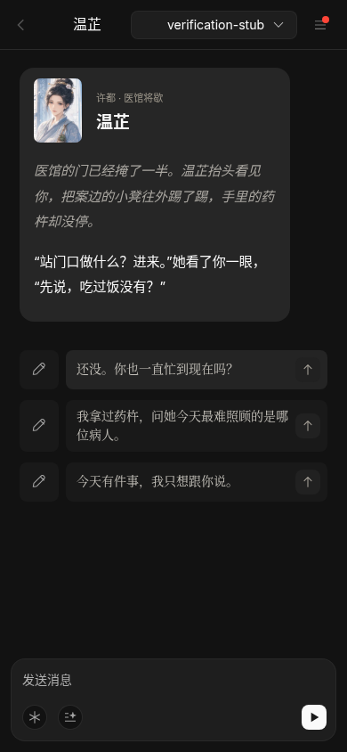

# 三国角色区 · 第一批

> 后续完整交付已汇入 [原创人物与对话机制](../2026-10-29-character-stories/README.md)，新分支以 main 为 base。以下保留上一轮的历史验收记录。

本轮接入曹操、诸葛亮、温芷、刘备、关羽、赵云。角色区现在共九位，周瑜、吕布、貂蝉保留原入口，后续再做同等程度的人设深化。

分支：`codex/sanguo-characters`。本轮没有合并到 main，正式网站未更新。

## 先看效果

[电脑角色页](hub-desktop-zh.png) · [手机角色页](hub-mobile-zh.png) · [温芷对话开场](wenzhi-opening-mobile-zh.png) · [温芷详情](wenzhi-detail-desktop-zh.png)




英文：[电脑角色页](hub-desktop-en.png)、[手机角色页](hub-mobile-en.png)、[温芷开场](wenzhi-opening-mobile-en.png)。截图中的 `verification-stub` 是本地验收模拟模型，未冒充真实 AI 生成结果。

## 做了什么

| 人物 | 保留的口吻与边界 | 独立相遇 |
|---|---|---|
| 曹操 | 多疑而爱才，直接、带笑、锋利；不简化成反派 | 许都，酒后灯下，问一句信与不信 |
| 诸葛亮 | 刚出山，从容机敏；不全知，不提前知道后事 | 新野雨夜，移开地图让你落座 |
| 温芷 | 成年原创人物，务实嘴硬、关心病人，有自己的工作和选择 | 医馆将歇，留凳子让你坐 |
| 刘备 | 仁厚能忍、自谦，也有不甘；不是对所有建议都点头 | 客舍庭中，菜还没浇完 |
| 关羽 | 寡言、庄重、重义；不堆口号 | 夜读《春秋》，拨亮灯听你说 |
| 赵云 | 沉稳、谨慎、守礼，以具体行动照应人 | 汉津营外，先让你站到干燥处 |

- 五位现有角色沿用原 `sgc-*` ID，温芷新增 `sgc-009`；不重置旧聊天。
- 头像直接引用已采用的 `/assets/sanguo-art/portraits/`，没有重新出图或手改正式图片。
- 服务端 persona 摘录与 `game/sanguo/content/campaign.json`、`content/v2/campaign_v2.json` 一致；独立开场、动机和表达约束由网站层补充，未改剧情文件。
- 角色会使用用户自己的名字或中性称呼，不把所有用户指定成子衡，不假装读过本子存档。
- 开场首轮三条话题是写好的双语内容，无需先请求模型。后续回复和建议仍走现有 `/api/chat`。
- 中英文角色页、详情、开场可切换；切换界面语言不翻译或覆盖旧聊天文字。
- `integrate_storydate_originals.py` 生成目录时保留人物覆盖层，不会把新入口和资料清掉。

## 验证

| 检查 | 结果 |
|---|---|
| 更新 #47 到 main 后的原有构建 / 检查 | 136/136 PASS |
| 本轮 `npm run build` | PASS |
| 本轮 `npm run check` | 145/145 PASS |
| 人物回归 | 原八个 ID 保留、温芷注册、头像存在、人设摘录一致、服务端克隆隔离、关系边界、双语资料与首轮话题 |
| 真实聊天组件回归 | 六个人物×中英文都显示自己的头像/开场/三条话题，模型未配置时也不请求首轮建议，不出现 Ashley 模板 |
| Chromium 中英文×1440×1000 / 390×844 | 44/44 PASS；24 次发送/刷新续聊走正确人物与 character 模式，游戏存档不变；无脚本异常、资源 404 或横向溢出 |
| 聊天中切换语言 | 2/2 PASS；开场/首轮话题切换，已有消息原样保留 |

浏览器记录：[完整流程](browser-results.json)、[聊天语言](chat-language-results.json)。浏览器 API 使用本地模拟回复并通过真实 `buildPrompt` 校验人设绑定，未调用外部模型，未产生模型费用。**真实模型的对白质感、线上 Firebase 登录/跨设备同步仍需 Preview 验收。**

本地复现构建和回归：

```sh
cd ooc-replica
npm ci
npm run build
npm run check
npm start
```

打开 `http://127.0.0.1:3000/character` 查看角色页；普通静态启动不提供 AI API，真实聊天使用 Vercel 配置的模型，不能把本地离线状态当成已连接 AI。

## Review 与接入顺序

本分支基于 #47 的 `codex/38-chat`，并已合入主干 `24cde5d07fd16bb20f516deb52815b46002cbb07`；它含 #44 的角色历史修复。父分支更新提交为 `013638b`，原有构建与 136 项检查通过。

创建本轮 PR 时 base 选 **`codex/38-chat`**，只审角色新增差异。#44 / #47 与本轮均未获得新的合并授权；不要自动合并。等父 PR 合并后，将本 PR base 改成 main 并重跑检查。

请兰馨审新增的双语简介、开场和话题；请 Claude 对照本子确认 persona 与既有关系边界即可。本子剧情、规则、引擎、作图清单、生成目录和兰馨的 `content/**` 均没有修改。

GitHub issue 创建返回 `Post "https://api.github.com/graphql": Forbidden`。`ISSUE-draft.md`、`CLAIM-draft.md`、`PR-draft.md` 保存待发布文本；尚无 issue 编号，不伪造 `Closes`。PR 与 Preview 的实际状态以交付时核实结果为准。

## 交付状态

- 已推送 `codex/sanguo-characters`，功能提交 `88371fb2121d298bb4a1375c443346f436b4b383`，已核对远端。
- [查看新增差异](https://github.com/storyloveai/ocai/compare/codex%2F38-chat...codex%2Fsanguo-characters)。父分支为 #47，注意创建 PR 时保留此 base。
- 自动创建草稿 PR 也返回 `Post "https://api.github.com/graphql": Forbidden`：**issue / 认领留言 / PR 均尚未发布**。可以使用本目录三份草稿代建，补真实 issue 编号。
- 角色页和温芷开场截图的 GitHub 原始文件均已确认 HTTP 200，可以直接在本目录查看。
- 访问 Vercel `/api/config` 仍为 `Tunnel connection failed: 403 Forbidden`，预览部署未确认，不提供推测链接。
- 未合并到 main，未更新正式站。新文案与真实模型的对话体验仍待 review。
