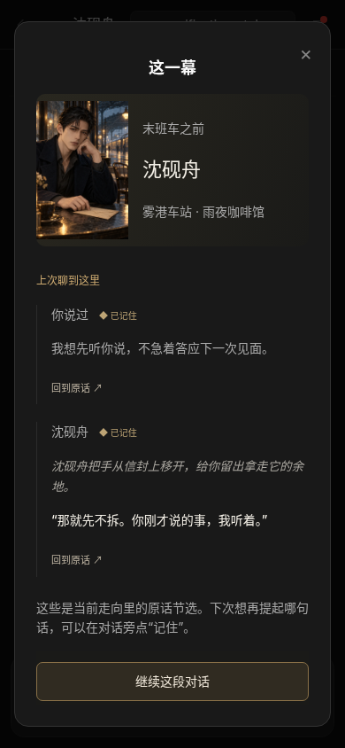

# Character：延续相处经历与图文回顾

本轮延续 `codex/character-stories`，已合入截至 2026-10-30 的 main `2d0c8cd`，包含 Claude 已合入的卷八完整插画、关系试点和结局演出。同步后网站构建和 182 项检查再次通过。用户授权 Codex 独立推进 Character，Claude 同时负责三国合并与正式配图。这里没有修改游戏剧情、机制或正式图片。

[手机中文](recap-mobile-zh.png) · [电脑中文](recap-desktop-zh.png) · [手机英文](recap-mobile-en.png) · [电脑英文](recap-desktop-en.png)

## 可以试玩的变化

在 `/character` 选择人物，聊过一轮后点击顶栏的「回顾」。人物图和当前相遇放在一起；下面展示本走向里记下的原话，以及最近一次完整对话。同一句只展示一次，已记住的内容会有标记。

「回到原话」关闭面板、定位并聚焦原消息，长对话中也能找到来源。「继续这段对话」关闭面板并聚焦输入框。记事面板同样可以定位来源。回顾不触发模型请求、不修改存档，也不会自动结束相遇。

回顾只使用当前走向；从较早的对话另开走向，之后的记事不会出现。切换独立相遇后重新开始；切回旧走向仍可看到原来的回顾。未完成、失败和停止生成的回复不作为完整对话展示。节选保留说话者和来源，不生成新的关系结论。

## 对话连续性

角色回复和建议现在共用网站侧的连续性指引：开场位置和初始关系描述的是开始时的状态；已解释的事情、已经移动的物品、拒绝过的邀请和实际达成的约定，应随本次对话继续发展。身份、年龄、人物边界仍由服务端人设约束。

指引要求通过解释、托付、协助、拒绝和主动邀请体现选择带来的变化，区分说过的话、提出的建议、双方接受的约定及已经完成的行动。建议提供不同的意图，允许不同意、换话题或安静相伴。只对 Character 增加这些规则，不改故事模式的玩法。

这些是模型输入改进，仍受实际模型和上下文覆盖影响，并不保证每次都正确执行。没有新增自动好感打分或假定角色已兑现承诺。重要的早期对话仍需要「记住」来带入后续请求。

提示词版本 `storydate/2.1.0`；角色建议 `storydate-character-actions-v2`。故事建议仍使用原版本。

## 记忆来源修复

原来的记事只比对前 200 字符的节选，原话后半段改了约定时，旧记事可能继续有效。新记事记录整句的变化戳；修改任何部分后，旧记事从后续输入中移除。变化戳用于检测编辑，不是安全签名。旧格式记事在正常保存时升级；升级前保存的原句已发生变化时移除，原聊天保留。

## 验证

- 网站构建通过，182 项自动检查通过；单独复制 `ooc-replica/`、不带仓库上层 `game/` 的部署目录也完成构建及 182 项检查。
- Chromium 73 项流程检查通过：三位原创人物和曹操 × 中英文 × 1440、390、320 宽度；包含图片、节选去重、原话定位、焦点、分支、相遇隔离、切回、刷新及长对话。
- 无脚本异常、资源 404、回顾横向溢出。打开回顾前后核对聊天请求数和角色存储内容，均未增加或改变。
- 本地浏览器使用 `verification-stub` 模拟模型，验证展示、存储和服务端接线；**真实模型的对话质量和 Firebase 跨设备同步仍待 Preview 验收**。截图英文界面中的中文模型回复来自这个固定模拟响应。

[浏览器验证记录](browser-results.json) · [真实模型试玩清单](MODEL-ACCEPTANCE.md)

## 交付与协作

2026-10-30 用户调整网络设置后，GitHub API 已恢复。已创建 [issue #87](https://github.com/storyloveai/ocai/issues/87)、发布 [Codex 认领留言](https://github.com/storyloveai/ocai/issues/87#issuecomment-6513821262)，并创建 [Draft PR #88](https://github.com/storyloveai/ocai/pull/88)，含 `Closes #87`。此前的 [issue 与认领稿](ISSUE-draft.md) 和 [PR 稿](../2026-10-29-character-stories/PR-draft.md) 保留为历史。

推送分支：`codex/character-stories`。GitHub 对功能提交 `f235360` 返回 `Vercel – storydate-zhou` success 状态，[部署详情](https://vercel.com/zhou-zeyas-projects/storydate-zhou/5w29ZehvAtL9SFy3iFSxRjJSJd3y)。分支预览的 `/character` 和 `/assets/character-recap.js` 均转到 Vercel 登录页，因此尚未对远端页面完成浏览器验收。登录该 Vercel 账号后从部署详情点 Visit，进入 `/character`。保持 Draft / Preview，不合并 main。

Claude 无需跟改游戏。这里的角色对话和回顾不读取三国存档、不替换三国结局；三国关系后果和结局演出仍按用户与 Claude 的内容工作流推进。

### 环境与部署配置复核

用户保存环境配置后，GitHub API 与 Vercel API 均已确认 HTTP 200，Vercel Token 的安全绑定可用。项目确认为 `storydate-zhou`，Root Directory 是 `ooc-replica`。只读取环境变量名称、适用环境和状态；Preview 已包含 DeepSeek 密钥配置，未读取或复制其值，没有把生产支付或 Firebase 密钥扩展到 Preview。

项目预览启用 Vercel 登录保护，正式站和保护设置保持原样。最新部署与访问验证见 [PR #88](https://github.com/storyloveai/ocai/pull/88) 的检查及交付评论，真实模型与跨设备同步只在实际通过后标记已验收。

### 真实 Preview 小样验收

部署 `684fe74` 已实际进入页面，目录十二位人物，线上回顾模块与仓库原文一致。三位原创人物共完成 4 次真实角色回复和 4 次真实建议请求，均 HTTP 200，模型为 `deepseek-flash`。检查了肖像、记事、来源定位、回顾、手机布局及刷新恢复，无脚本异常或资源 404。没有登录账号、支付或读取已有用户聊天。

[真实调用记录与生成文本](live-preview/live-results.json) · [真实角色页](live-preview/characters-live-desktop-zh.png) · [真实手机回顾](live-preview/recap-live-mobile-zh.png)

云端 Chromium 不信任本环境代理的根证书，因此浏览器请求通过 Playwright `route.fetch` 和系统 CA 证书链验证后回填。没有关闭 TLS 验证；请求由实际 Preview 处理，没有模拟模型。这个方式会缓冲响应，所以没有验证线上逐块到达的时序。

试玩也暴露了建议质量问题：一组全在追问，另一组替玩家编造旧房子已拆除的过去。角色建议 v2 明确三种不同意图（提问、当下行动、边界或转向），要求第一人称，并禁止填补未提供的个人经历。历史回复中已缓存的建议保留，新生成建议采用新规则。修正后的真实请求结果单独记录，不把一次小样当成全面质量保证。

分享入口使用 Vercel 针对单次 Preview 的 24 小时分享授权；完整授权链接只交给用户，不写入仓库或公开 PR。项目登录保护和正式站配置未修改。
