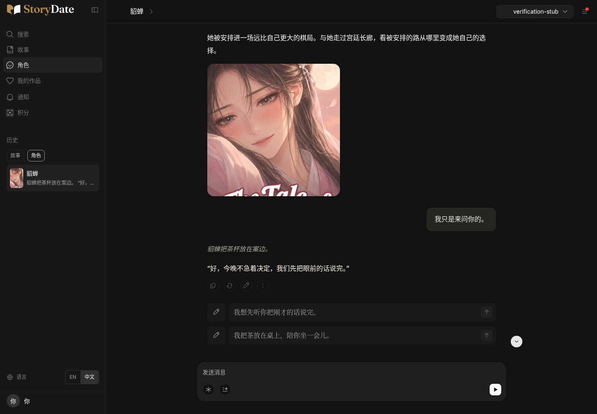

# 旧角色开场简介的语言修正

针对用户截图：中文会话里，貂蝉大图上方仍显示英文简介。

原因是旧角色首次进入会话时，`scenarios.json` 的英文 `opening` 优先于角色目录里已有的双语简介。角色会话现在使用所选语言的目录简介；创作者自行填写的开场和故事模式保留原有来源。默认访客名跟随语言显示“你”或“You”，已填写的名字不变。原貂蝉大图、布局和历史消息不变。

[电脑英文](diaochan-opening-desktop-en.png) · [手机中文](diaochan-opening-mobile-zh.png) · [手机英文](diaochan-opening-mobile-en.png)

## 验证

- main 同步至 `b31c910`；网站构建和 185 项自动检查通过。
- 自动回归使用真实 `scenarios.json`，避免空模拟数据掩盖英文开场优先级问题。
- 16 项本地浏览器检查通过：貂蝉、周瑜、吕布 × 中英文 × 电脑/手机的首次进入与刷新；原貂蝉入口进入、已有消息刷新、切换语言、图片来源及默认访客名。
- 浏览器使用实际目录及场景文件；生成回复用双语模拟服务，验证范围是开场与交互，不作为真实模型效果证明。线上部署复核单独记录在 PR #88。

[逐项结果](browser-results.json)

仍停在 Draft PR #88 / Preview，未合并。
