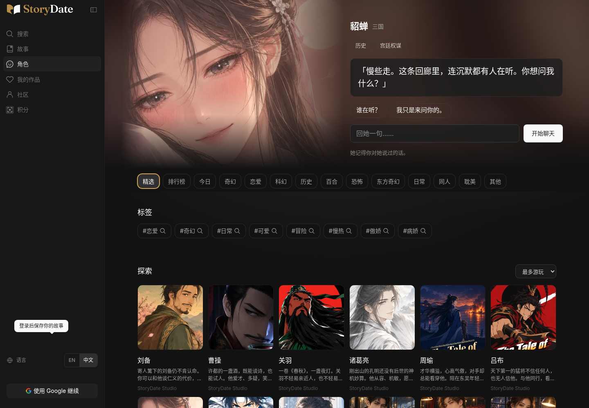

# Character：恢复貂蝉首屏与原有浏览交互

后续修正：[旧角色首开英文简介遗漏及专项验证](../2026-10-30-character-intro-language/README.md)。

按用户验收反馈修正 PR #88：保留已认可的对话能力，撤掉对原 Character 入口的整页替换。

[电脑英文](character-restored-desktop-en.png) · [手机中文](character-restored-mobile-zh.png) · [手机英文](character-restored-mobile-en.png)

## 恢复的部分

- `/character` 重新使用原来的貂蝉 Banner、原图与构图、选回复和自由输入入口。
- 原有分类、标签、探索书架、排序、角色资料弹窗与收藏流程继续使用；新人物按原卡片样式加入现有书架，目录共十二位。
- 原人物的资料入口恢复原有展示，独立相遇页只用于新加入的三位人物。
- 对话分层、记事、分支与回顾保留；没有重置已有聊天、账号存储或游戏存档。

没有改 `hero-scene.js` 或貂蝉图片文件。原先新增的人物列表页不再接管 `/character`。

## 中英文修正

界面文字、人物名、输入框、状态、工具按钮及设置弹窗跟随语言开关。手机会话的语言开关放在已有顶栏右侧；电脑继续使用侧栏位置。手机设置抽屉缺少关闭按钮，现补上关闭入口。

新回复及新建议将所选 `zh` / `en` 发给服务端，服务端校验允许值并明确指定输出语言。无显式语言的旧请求仍使用原来的自动检测。点击「继续」在中文界面发送中文，不再固定使用英文。

建议按语言分别缓存；切回已生成的语言不会重复请求。切换后才到达的旧语言结果不能覆盖当前建议。原来的用户消息、角色回复和记事引用保留原文，语言开关不改写历史。

设置按钮按稳定标识执行，不再靠已翻译的显示文字匹配。自动生成的相遇标签同样随语言切换；来源于用户原话的标签保留原文。

## 验证

- main 同步至 `8edff50`；网站构建及 185 项自动检查通过。
- 16 项浏览器流程通过：中英文 × 电脑/手机，覆盖貂蝉 Banner、原书架十二位人物、筛选、角色弹窗、收藏、对话、请求语言、缓存切换、历史原文保留、设置与貂蝉大图开场、继续操作。
- 另验证迟到的英文建议不能覆盖切回后的中文建议；手机顶栏在两种语言下无横向溢出。
- 本地使用双语模拟模型验证交互，不作为真实模型语言效果的证明；线上复测结果在 PR 交付评论里单独记录。

[流程记录](browser-results.json) · [语言切换竞争记录](language-race-results.json) · [手机会话中文](conversation-mobile-zh.png) · [手机会话英文](conversation-mobile-en.png)

只改网站角色模块与自己的进度行；不手改游戏剧情、机制、正式图片或生成副本。仍停在 Draft PR / Preview，未合并。
