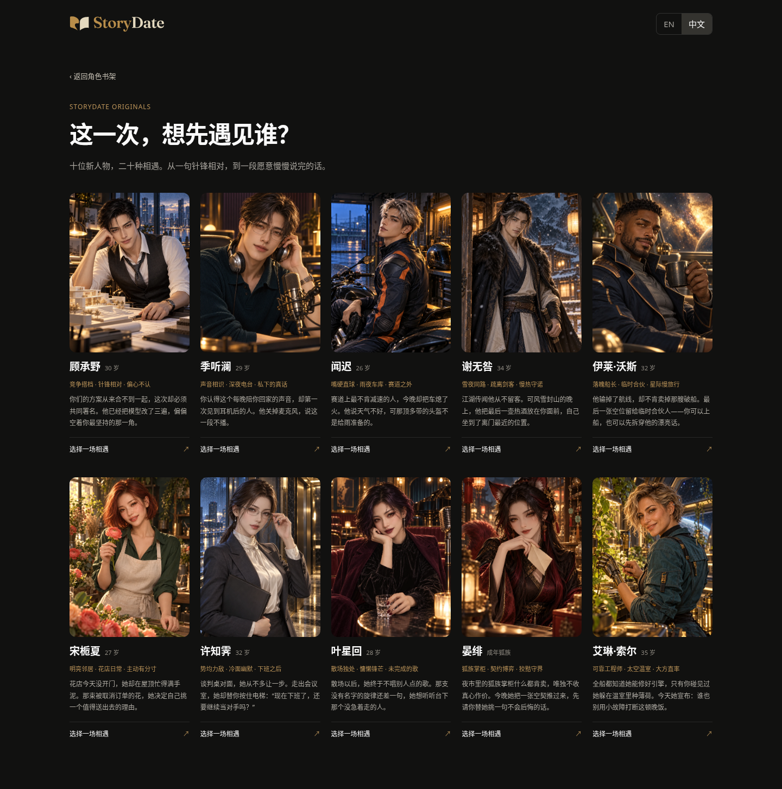

# Character：十位原创成年人物

任务 #94。沿用已验收的貂蝉首页、原分类和探索卡片；原目录十二位保留，新加十位，合计二十二位。

新增角色也有两套独立相遇、双语简介/开场/起手选项、服务端限定的人物动机和说话方式，接入现有连续对话、记事、分支与图文回顾。角色设定不会写入三国剧情、规则或存档。

## 可以从哪里看

- `/assets/character-wave-one.html`：十位新角色的双语比较页，可直接进入各自资料和两种相遇。这个页面不替换原 `/character`，不接管原导航。
- `/character`：保留貂蝉入口，新人物在原探索卡片中。

| 人物 | 年龄 | 题材与交流重点 | 两种相遇 |
|---|---|---|---|
| 顾承野 | 30 | 竞争搭档；能反驳，也能具体让步 | 共同署名 / 断电露台 |
| 季听澜 | 29 | 深夜电台；下班后的真实对话 | 这一段不播 / 拿错的伞 |
| 闻迟 | 26 | 赛道之外；嘴硬但能直说 | 雨夜停赛 / 借工具 |
| 谢无咎 | 34 | 古风剑客；同路与守诺 | 风雪客栈 / 归还剑穗 |
| 伊莱·沃斯 | 32 | 星际船长；平等协商与日常笑料 | 最后船票 / 失重晚餐 |
| 宋栀夏 | 27 | 明亮花店；有主见的日常相伴 | 取消订单 / 屋顶花园 |
| 许知霁 | 32 | 势均力敌；工作外的冷面幽默 | 谈判后 / 书店争书 |
| 叶星回 | 28 | 爵士歌手；台上台下的区别 | 最后听众 / 天台小样 |
| 晏绯 | 216，外貌约 30 | 成年狐族；能谈清的契约和反差 | 空白契约 / 雨天歇业 |
| 艾琳·索尔 | 35 | 太空工程师；可靠、坦率、会休息 | 温室晚饭 / 不必要的维修 |

十张肖像均为内置生成工具独立创作，详见[配图记录](../../../character-art/wave-one/README.md)。没有复制或改画竞品人物图。

## 公开产品研究及应用边界

2026-10-30 只读访问 [Tipsy 公共首页](https://tipsy.chat/) 与 [Zeta 公共英文首页](https://zeta-ai.io/en)，HTTP 200，没有登录、抓取私人对话或绕过访问控制。

- Tipsy 的可见公共页面给出推荐、趋势、最新、热门、关注等发现方式；首页介绍强调角色、故事及世界创作。本次未登录页面只返回有限的目录框架，不能据此声称验证了其完整对话、记忆或关系机制。
- Zeta 可见的公共目录将短场景简介与关系/题材标签放在角色发现入口，让人先知道眼前是什么关系、有什么冲突。可借鉴的是信息层级，不能把热门角色的设定和图片当作我们的内容。
- 本批应用：一句明确的相遇矛盾、三项可辨认标签、人物作为视觉焦点、直接可选的开场行动，并用现代/古风/科幻与不同性格做差异。全部人物、姓名、图、简介、开场和服务端设定独立创作。
- 原有对白暖白、动作灰色斜体的阅读分层继续使用；未登录竞品首页不提供足够证据证明其私聊的排版细节，因此不作相关实测宣称。
- 本次不依据第三方的显示热度编造本站浏览量，不把“免费”或留存宣传视作可验证的业务效果。

## 验证与交付

网站构建和 196 项自动检查通过。40 组本地浏览器验证覆盖十位角色 × 电脑/手机 × 中英文：原书架发现、肖像加载、资料、两种相遇、回复/建议的语言、刷新保存及相遇隔离；另检查记事和带角色图的回顾。四组比较页验证十张图片、中英文及无横向溢出，页面脚本异常 0。

[角色流程记录](browser-results.json) · [比较页检查](gallery-results.json)

[电脑英文](ten-portraits-desktop-en.png) · [手机中文](ten-portraits-mobile-zh.png) · [手机英文](ten-portraits-mobile-en.png)

本地对话用双语模拟响应验证交互，真实模型抽查与 Preview 复核另在 PR 评论记录，二者不混为模型效果证明。

不改 `game/**`、兰馨内容目录、三国正式图及同步生成文件。PR 停在 Draft / Vercel Preview，等待用户验收，不合并。
